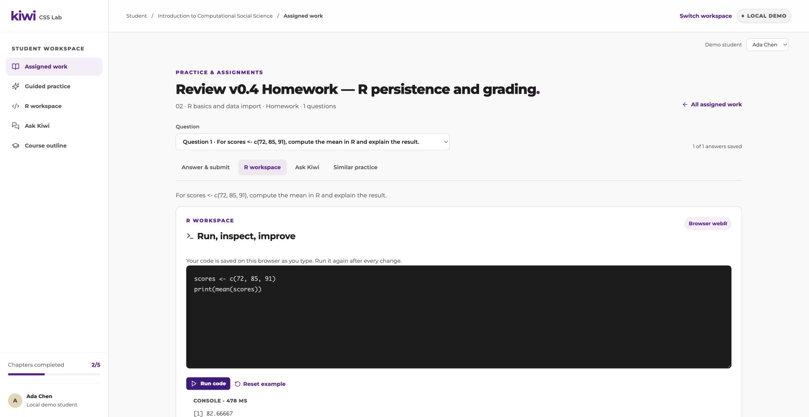

# v0.4.0 independent browser review — partial

- Review date: 2026-10-15.
- Tested version: `0.4.0` in `package.json`; development app at `http://127.0.0.1:8100`.
- Reviewer: independent review agent, separate from the implementation agents, following `AGENTS.md`.
- Browser: real Chrome, session named **🔎 Kiwi v0.4 Review**. Functional actions used CUA accessibility controls and supported browser Playwright locators. No direct API mutations were used for these results.
- Scope actually completed: standalone local demo teacher and student UI, with real browser webR execution and returned Kiwi AI responses. Desktop viewport measured **1920 × 992** on the main review tab.
- Status: **partial; required end-to-end review is not complete**. Browser control was stopped before grading, analytics, policy, and narrow viewport checks. No implementation files were changed by the reviewer.

## Review data and preservation

Only clearly named review assignments and their student work were created or changed. Existing assignments and grades were left intact.

| Item | Actual identifier / evidence |
| --- | --- |
| Course | Local demo course, “Introduction to Computational Social Science” |
| Student | Ada Chen, local demo student shown in the UI |
| Homework | **Review v0.4 Homework — R persistence and grading**; `work-464c892a80c647b7` |
| Homework question | `q-abaaa4f1-bdd2-439e-9d9e-89a51e63261b` |
| Practice | **Review v0.4 Practice — repeated attempts**; `work-c7829ce1ae3d412e` |
| Practice question | `q-9604004c-6d01-4962-8632-d64dd1c23955` |
| Homework submission | UI confirmed **Attempt 1**, received `10/15/2026, 2:38:17 AM`; internal submission ID was not inspected |

The local teacher access key was read from the local credentials file and entered into the configured local teacher form. It is not included in this report or screenshots. The official host at `http://localhost:3001/login` opened an existing demo.student session; no assignment, teacher, or Data Hub workflow was exercised on that host.

## Actual steps and observed results

| Flow | Actual browser steps | Observed result |
| --- | --- | --- |
| Workspace entry | Opened `/entry`, waited for course context, selected Teacher workspace. | Student and teacher entry cards appeared. Teacher navigation exposed separate Practice & assignments, Course management, and Data analytics routes. |
| Teacher access and assignment list | Entered the configured local teacher access key. | Opened `/teacher/work/assignments`; assignment search, status filter, Edit, Grade, and publish controls were visible. Existing work was retained. |
| Homework creation and publication | Used New assignment. Selected Homework and chapter “02 · R basics and data import”. Entered title, English instructions, written question, reference answer, and rubric. Saved draft, returned to list, searched `Review v0.4 Homework`, clicked Publish. | Draft received a stable work URL, then list showed **Published**. [Publication screenshot](v0.4.0-homework-published-desktop.jpg). |
| Practice creation and publication | Created a second assignment as Class practice, same chapter. Added multiple choice question `What is mean(c(2, 4, 6)) in R?`, choices `2`, `4`, `6`, reference `4`, and English explanation. Saved, searched the title, clicked Publish. | Practice appeared as **Published**, with one question. |
| Student assignment navigation | Switched workspace, entered Student workspace, opened the published homework. Used Answer & submit, R workspace, and Ask Kiwi tabs. | Distinct route pages loaded, retaining the assignment and question context. No anchor-scroll-only behavior was observed for these tabs. |
| Homework answer persistence | Typed `Review v0.4 draft: scores <- c(72, 85, 91); mean(scores) = 82.66667. The average score is about 82.67.` Navigated to R workspace, then Kiwi; reloaded the Kiwi route; returned to Answer & submit. | Header showed `1 of 1 answers saved`. The exact answer was still in the answer field after the page changes and reload. This verifies browser-local answer persistence, not cross-device draft synchronization. |
| Real R success | In the assignment R workspace, ran `scores <- c(72, 85, 91)` followed by `print(mean(scores))`. | webR console returned `[1] 82.66667` with execution timing. [R success screenshot](v0.4.0-student-r-success-desktop.jpg). |
| Real R error and recovery | Changed the second line to `print(mean(scorez))`, ran it, asked Kiwi about the error, then returned to R and corrected `scorez` to `scores`, and ran again. | Console displayed `object 'scorez' not found` and a variable spelling/capitalization tip. Corrected execution returned `[1] 82.66667`. This was real browser execution; R editor persistence across reload was not separately verified. |
| Assignment Kiwi conversation | Asked about the `scorez` name mismatch. Asked a follow-up about R case sensitivity and a tiny reproducible example. Reloaded the conversation page. | Two English AI replies explained spelling and case sensitivity, with R code examples. Both user turns and both AI replies reappeared after reload in the same assignment question thread. [Reload screenshot](v0.4.0-kiwi-history-reload-desktop.jpg). |
| Homework submission | Returned to the persisted homework answer and clicked Submit assignment. | UI confirmed Submission 1 received and **Awaiting teacher review**. [Submission screenshot](v0.4.0-homework-submitted-desktop.jpg). Teacher grading and student grade visibility remain pending. |
| Repeated practice attempts | Opened the named review practice. Selected `2`, clicked Check practice answer, then selected `4` and checked again. | First attempt showed **Try again**; second showed **Correct** and the authored explanation. Whether both attempts are grouped correctly in teacher analytics remains pending. |
| Generated similar exercise | Opened Similar practice and generated at difficulty `2/5`. | Returned an AI multiple choice exercise, “Mean of a numeric vector,” with `mean(c(2, 4, 6))` and choices `4`, `6`, `2 4 6`, `12`. This repeats the source question; see P2 below. |
| Generated answer and continuation | Selected `4` and clicked Check similar answer. Then clicked Next similar exercise. | Answer showed **Correct** and an English arithmetic explanation. Next request visibly entered **Generating…**; its returned exercise was not inspected before browser work stopped. Continuation success is therefore not established. |

## Findings

### P2 — Similar practice repeated the source question unchanged

- Reproduction: student opens **Review v0.4 Practice — repeated attempts** → Similar practice → Generate similar exercise at `2/5`.
- Source question: `What is mean(c(2, 4, 6)) in R?`
- Generated question: `What does the following base R code return? mean(c(2, 4, 6))`
- Result: the numeric vector, operation, and correct answer are unchanged, despite the page promise “Try the idea with new data.” The generated exercise checks the same answer without creating a new transfer opportunity.
- Expected: change the data or context while preserving the target concept, or describe the feature accurately if source repetition is allowed.
- Severity rationale: the workflow functions but the learning value and promise of a new exercise are reduced.
- Sent to implementation immediately during review. The implementation agent proposed server-side novelty validation and regeneration. **Fix has not been retested in the browser.**
- The generated prompt and correct feedback were observed in the accessibility tree and screenshot emitted during the tool session; that screenshot was not saved as a review artifact before the stop. The report does not imply a saved image exists for this finding.

No P1 blocker was observed in the completed subset. This is not a pass for the incomplete review scope.

## Desktop visual observations and evidence

The emitted desktop screenshots of the assignment R page, Kiwi conversation, and similar practice page showed readable text, contained panels, clear active tabs, and no visible overlap in the inspected views. The R editor and console were legible. The long review assignment heading fit at desktop width. No narrow-screen conclusion follows from these desktop observations.

Saved screenshot artifacts:

- [Workspace entry](v0.4.0-entry-desktop.jpg)
- [Homework publication](v0.4.0-homework-published-desktop.jpg)
- [Real R success](v0.4.0-student-r-success-desktop.jpg)
- [Kiwi history after reload](v0.4.0-kiwi-history-reload-desktop.jpg)
- [Homework submission](v0.4.0-homework-submitted-desktop.jpg)

## Difficulties and interruption

1. `getByLabel('Chapter')` did not resolve this form. A fresh DOM snapshot exposed the accessible combobox name, and `getByRole('combobox', { name: 'Chapter', exact: true })` worked. The authoring workflow continued successfully.
2. Browser-scoped viewport `set({ width: 390, height: 844 })` did not change the measured main tab viewport: `innerWidth` remained `1920` and document scroll width `1920`. A new tab created afterward also reported width `1920`. These attempts are **not** responsive test results. No 390 or 320 screenshot is labeled as passed.
3. While trying to inspect the supported native Chrome surface for responsive tools, the following exact CUA call returned a stop instruction:

   Tool: `mcp__cua_repl.js`

   Call: `var chromeReviewApp = await cua.getApp('Google Chrome');`

   Tool title: `Inspect Chrome responsive tools`

   Exact returned text:

   > This application session has been explicitly stopped by the user for this turn. Stop your work and send a final message noting they stopped the session and you're ready to continue if they want you to. Computer Use can be used again in the next assistant turn.

Browser work stopped at that point. This report was subsequently written through filesystem tools only, on the implementation agent's documentation-only follow-up. No attempt was made to resume CUA during this follow-up.

## Required checks still pending

- Teacher grades the actual review homework submission; student sees the saved grade and feedback after reload.
- Teacher Data Hub and activity history on the official Kiwi host.
- Data analytics overview metrics and each metric's link into filtered real interaction tables.
- Student search; interaction, code-run, and answer-attempt sorting; chapter/topic, assignment, question, and event-type filtering; pagination and empty states.
- Drill from Ada Chen to chapter → question/code/dialogue thread → full session; verify that the actual repeated practice attempts, R success/error/correction, and Kiwi dialogue above are complete and correctly clustered.
- Question/assignment evidence: accuracy, average attempts, option distributions, per-student results, common questions, topic question averages, and original question detail.
- Course management: current chapter, completed chapter changes, course edits, and navigation after save/reload.
- Generation policy editing with restoration of original values; difficulty/type bounds; teacher prompt priority and student override rejection through actual browser workflows. Backend tests are not counted here as browser passes.
- General Guided practice generation, answer retry, continuation, and persistence. Similar practice was partially tested as described above.
- Retest P2 novelty correction after the implementation and API restart.
- Desktop screenshot inspection of teacher analytics, course, policy, grading, and student feedback screens.
- **390- and 320-pixel viewport** entry pages, student/teacher navigation, key cards, long text containment, spacing, legibility, and horizontal overflow. Actual narrow width must be confirmed before claiming responsive success.
- Official host iframe behavior and role restrictions, including real teacher entry. The standalone local demo deliberately uses a teacher access key and local demo identities.
- Cross-device drafts, multi-user concurrency, large-course load, and robustness beyond the limited browser sample.

Legacy stored assignment titles included Chinese text. Those are preserved existing user/test content; this review did not translate them and did not establish the language of every stored instruction or prompt. The newly created review work and observed AI replies were English.
