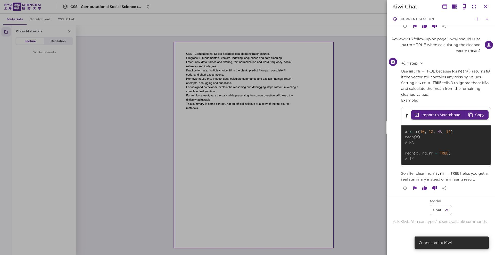

# v0.5.0 independent browser review — partial

- Review date: 2026-10-15, approximately 13:41–13:45 UTC.
- Requested version: v0.5.0, implementation running through Kiwi `http://localhost:3001` and embedded CSS Lab `http://127.0.0.1:8100`.
- Reviewer: independent review agent, separate from implementation, following `AGENTS.md`.
- Browser: real Chrome, dedicated session **🔎 Kiwi v0.5 Review**, review tab `1333871128`.
- Functional actions used CUA and supported browser locator methods. Native activity was produced by actual student UI actions, not direct API writes or database seeding.
- **Status: incomplete.** Student entry/return and native lecture conversation were exercised. Native R and login issues were reported immediately. Teacher integration, full regression, and actual narrow layout checks remain pending. Implementation fixes were not retested before the native control surface returned a stop instruction.

## Preservation and test identity

The browser initially had an authenticated `demo.student` session. The Lab showed `demo.student@css-kiwi.local` and the expected course context. Only clearly marked **Review v0.5** native code and AI questions were entered. No existing assignments or grades were edited, no submissions were graded, and no v0.5 assignment was created before interruption. The reviewer did not seed any native coding or PDF records.

The requested pre-review snapshot `.local/v0.5-original-records.json` remains the implementation agent's preservation baseline; this reviewer did not use database-only evidence to claim a UI pass.

## Completed browser steps and observed results

| Flow | Actual browser steps | Observed result |
| --- | --- | --- |
| Student course-card launch | Opened Kiwi `/` in a dedicated review tab. After home content loaded, inspected the course card and clicked the new **Open CSS Lab** link below it. | Link was visible below **CSS - Computational Social Science (Local Demo)**. It navigated to `/local-css-demo/app/ics-r-lab`. [Home screenshot](v0.5.0-student-home-entry-desktop.jpg). |
| Student live role and course SSO | Waited for the embedded Lab to load. | Lab opened directly on `/student/assignments`, showed **KIWI LIVE**, `demo.student@css-kiwi.local`, **Kiwi student**, and **Introduction to Computational Social Science**. No teacher key form appeared. [SSO screenshot](v0.5.0-student-sso-desktop.jpg). |
| Back to Kiwi | Clicked the Lab **Back to Kiwi** button. | Returned to native course `/local-css-demo` with the **Materials** tab selected. This verifies the student return path. |
| Native scratchpad success case | Opened native **Scratchpad**, selected **R**, typed `# Review v0.5 native scratchpad success`, `scores <- c(10, 20, 30)`, and `print(mean(scores))`, then clicked the play control. | Toast said **Code executed and files updated.** Output remained **Output will appear here.** Expected `20` was not visible. Native success is **not passed**; see P1 below. [Output screenshot](v0.5.0-native-r-no-output-desktop.jpg). |
| Native scratchpad error case | Replaced the editor with `# Review v0.5 native scratchpad deliberate error` and `print(review_v05_missing_object)`, then clicked play. | Same success toast appeared, while Output remained the placeholder. No R error was visible. This is an actual second UI run, but correct error reporting is **not passed**. |
| Native lecture/PDF rendering | Returned to **Materials** and waited for the selected file. | `CSS-demo-course-context.pdf` rendered page **1 / 1**. Its text covered R fundamentals, vectors, indexing, data cleaning, later topics, and homework guidance. The side **Class Materials** panel simultaneously said **No documents**; see P2. |
| Native lecture AI turn 1 | Opened native Kiwi Chat while viewing page 1. Asked: `Review v0.5 lecture reading: On page 1 of CSS-demo-course-context.pdf, how do vectors and indexing help with data cleaning? Give a short English explanation and one R example.` | A real English AI response explained batch operations, selecting and cleaning values, and supplied an R vector/indexing example. |
| Native lecture AI follow-up | In the same displayed current session, asked: `Review v0.5 follow-up on page 1: why should I use na.rm = TRUE when calculating the cleaned vector mean?` | A second English response explained ignoring missing values and gave `mean(x)` versus `mean(x, na.rm = TRUE)`. Both turns were visible in the same native conversation. [Thread screenshot](v0.5.0-native-lecture-thread-desktop.jpg). Thread persistence after reload and teacher export evidence remain pending. |
| Account switch attempt | Closed chat and clicked the Logout link. The page did not visibly navigate. Inspected the rendered link `/logout`, then used that observed URL. | Direct normal `/logout` navigation reached `/login`. Console also reported a React state update warning involving `AuthProvider` and `Logout`. |
| Teacher login | Entered `.local/demo-credentials.json` teacher email/password privately. Tried both native input setting and normal browser textbox fill; submitted Login. | Both attempts showed **Login failed. Please check your credentials and try again.** Teacher workflows were blocked. Passwords were never printed or captured in report artifacts. |
| Student login retry | Entered the configured student email/password through browser textbox fill and submitted Login. | Same visible login failure. The initially authenticated student workflows above passed without reauthentication; fresh sign-in did not. Implementation agent was notified to verify running auth configuration and credentials. |

The reviewer did not inspect native record IDs or a teacher export table. No claim is made that these UI events were correctly synced, scoped, paginated, deduplicated, or attributed in analytics.

## Actionable findings sent to implementation

### P1 — Native R displays success while producing neither output nor an error

Reproduction:

1. In the authenticated student course, open **Scratchpad**, select **R**.
2. Enter `scores <- c(10, 20, 30)` and `print(mean(scores))`; click play.
3. Observe **Code executed and files updated.**, but Output still says **Output will appear here.**
4. Enter `print(review_v05_missing_object)` and click play.
5. Observe the same success toast and unchanged output placeholder.

Expected: print the actual result for the first run; display an R error for the second; report success/error accurately in native activity.

Impact: students cannot inspect or debug native R work, and the new analytics integration cannot be trusted to classify the demonstrated runs until verified. This is a blocker for claiming the native code workflow works end to end.

The implementation agent identified upstream error swallowing and output capture problems and began a runner fix. **No fix retest was completed.**

Console evidence collected through the supported browser log API:

- Repeated `Maximum update depth exceeded. This can happen when a component calls setState inside useEffect, but useEffect either doesn't have a dependency array, or one of the dependencies changes on every render.` at approximately `13:42:19` and `13:42:40–41 UTC`.
- `WebR is using PostMessage communication channel, nested R REPLs are not available.` warning.
- `Failed to read plot file: T: ErrnoError: 44` twice at `13:43:50 UTC`.
- The maximum-depth entries exposed `http://localhost:3001/@vite/client` as URL and no component stack. The reviewer did not infer a specific source component from that evidence.

### P1 — Fresh teacher and student sign-in failed with configured demo credentials

Both teacher attempts and one student attempt on the rendered `/login` form returned the visible generic login error. The configured file was loaded privately; UI operations used actual browser form events. This blocked all new teacher SSO, analytics, grading, and materials mapping checks.

Console provided a `ResponseError` stack from `DefaultApi.request` (`src/services/runtime.ts:109`) through `authControllerLoginRaw` (`src/services/apis/DefaultApi.ts:480`) and `handleSubmit` (`src/pages/Login.tsx:31`). HTTP status or response details were not exposed by the collected log entries. After browser work stopped, the implementation agent independently confirmed that the retained local credential file mismatched the database password hashes for both demo accounts and began repairing only those known local account password fields. That is implementation-side diagnosis, not a successful browser retest.

No sign-in fix was retested, and no existing assignment or grade content was changed by this reviewer.

### P2 — Materials sidebar says “No documents” while a course PDF is displayed

The native Materials screen showed the real file `CSS-demo-course-context.pdf`, page 1 / 1, and its readable content, while the **Lecture** list in the left **Class Materials** sidebar said **No documents**. This makes finding/reselecting the available material unclear and creates contradictory feedback. The implementation agent was notified. It is not established whether this comes from material metadata, grouping, or the sidebar.

### Observation — Logout required direct navigation

Clicking the rendered Logout link did not visibly navigate during the inspected state. Using its observed `/logout` URL reached login. Console warning:

`Cannot update a component (AuthProvider) while rendering a different component (Logout).`

This was sent as diagnostic context. It was not independently reproduced after a reload, so it remains an observation rather than a confirmed standalone regression.

## Screenshots and visual observations

Desktop screenshots of student home and hosted Lab showed the new launch button below the course card, recognizable active navigation, contained text, and readable identity/course context. The native PDF and chat were legible in the inspected desktop view. Native scratchpad's missing output is functional evidence, not a visual pass.

Saved artifacts:

- [Student home launch button](v0.5.0-student-home-entry-desktop.jpg)
- [Live student Lab identity/course](v0.5.0-student-sso-desktop.jpg)
- [Native R unchanged output panel](v0.5.0-native-r-no-output-desktop.jpg)
- [Native lecture conversation and PDF](v0.5.0-native-lecture-thread-desktop.jpg)

Actual 390- and 320-pixel viewports were not measured or inspected in this review. Existing browser-scoped viewport limitations from v0.4 were not relabeled as responsive passes.

## Browser-control interruption

After sign-in failures, the reviewer attempted the documented native Chrome surface to inspect responsive controls. This exact call returned the stop instruction:

- Tool: `mcp__cua_repl.js`
- Call: `var v05Chrome = await cua.getApp('Google Chrome');`
- Tool title: `Inspect native Chrome responsive controls`

Exact returned text:

> This application session has been explicitly stopped by the user for this turn. Stop your work and send a final message noting they stopped the session and you're ready to continue if they want you to. Computer Use can be used again in the next assistant turn.

Browser tab APIs had worked before that native lookup. The reviewer stopped UI actions immediately, notified the implementation agent with the exact text, and wrote this partial report using filesystem tools. No attempt was made to bypass or resume the stopped native surface.

## Required review work still pending

- Retest native R runner with success, actual error, correction, and printed output after implementation fixes; verify error metadata in teacher evidence.
- Restore working fresh sign-in for both demo accounts through the real UI.
- Teacher `/admin/classes` **Open CSS Lab** button, live teacher role/course SSO without a teacher key, and teacher **Back to Kiwi**.
- Teacher analytics **Kiwi** versus **CSS Lab** source filter and actual native scratchpad code/output records from the UI runs above.
- Native lecture/PDF thread evidence: filename/material, page 1, both question/reply turns, complete thread/session grouping, and correct student/course attribution.
- Automatic 30-second sync and manual **Refresh Kiwi activity**; verify the export safety delay without missing latest records.
- History pagination, exclusion of legacy `app-ics-r-lab-*` duplicates, and enrolled-student-only native scope through reviewable UI evidence.
- Course materials mapping at `/teacher/course/materials`, saving/restoring a mapping, and its effect on topic/chapter analytics.
- Full assignment regression: teacher creates/publishes clearly named **Review v0.5** homework/practice, student draft survives page changes/reload, real Lab R success/error/debug, student submits, teacher grades, student sees grade after reload.
- Generated questions: answer, retry, continue, persistence, and novelty correction from v0.4. Similar exercise continuation must return an inspected new exercise before it can pass.
- Lab Kiwi conversation, teacher generation policy bounds/priority, and attempted student override rejection through actual UI.
- Teacher Data Hub and activity history.
- All overview metric links, search/sort/filter/drill, question/assignment evidence, student distributions, and complete sessions for repeated attempts/code/chat.
- Actual desktop inspection of new teacher screens plus measured **390** and **320** viewport entry pages, role navigation, cards, text containment, spacing, legibility, and overflow.
- Cross-device drafts, concurrent use, and large-course robustness beyond this small browser sample.

The reviewed subset demonstrates working student entry/return and native lecture chat, but does **not** establish v0.5.0 end-to-end readiness. Remaining items must stay pending in delivery and future work.
